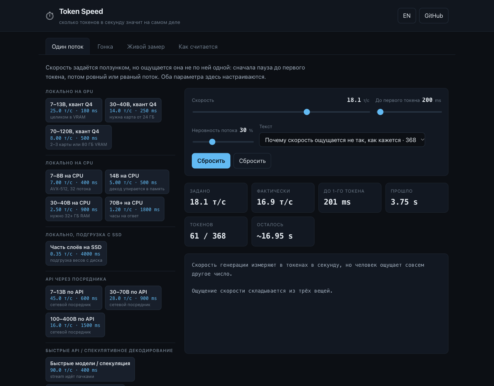

# Token Speed

**[Live: tayuluc.github.io/token-speed](https://tayuluc.github.io/token-speed/)**

What LLM generation speed actually feels like — a slider for tokens per second,
a separate control for the wait before the first token, a race between several
speeds at once, and a real measurement tab that times any OpenAI-compatible
endpoint from your browser.

No build step, no dependencies, no tracking. Open the URL and it works.



## Why it exists

The starting point was [vsegpt.ru/pdfs/token_speed.html](https://vsegpt.ru/pdfs/token_speed.html):
a single static page with a slider and a set of preset speeds that types out a
pre-baked token array with `setInterval(1000 / tps)`. It does one thing, and it
is a good thing to be able to do. Three things are missing from it:

1. **The wait before the first token.** Every real API spends time on prefill
   before the first token appears. A demo that starts instantly teaches the wrong
   intuition: it makes a two-second wait look like a fast response.
2. **An honest rate.** `setInterval(1000 / tps)` does not deliver `tps`. Measured
   in Chromium 154, a 5 ms interval whose callback costs 25 ms streams
   **40.3 tokens/s while claiming 200**. At 25 tok/s the same code is fine —
   which is why the mistake survives until someone turns the slider up.
3. **Comparison.** One stream at a time hides the only interesting question:
   which part of the delay is decode and which part is waiting.

## What was measured, not asserted

Everything the page claims about itself is reproduced in
[`tools/measure-baseline.md`](tools/measure-baseline.md).

The scheduler asks "how many tokens should be on screen by now?" and emits the
difference, so a late frame catches up instead of silently losing tokens:

| Target tok/s | 10 | 25 | 150 | 250 |
|---|---:|---:|---:|---:|
| Measured tok/s | 10.03 | 25.11 | 151.01 | 252.01 |
| Error | +0.27 % | +0.42 % | +0.67 % | +0.80 % |

Turn on unevenness and the mean is preserved on purpose: 26.22 at 25 tok/s,
123.27 at 120. Real providers batch tokens, and the demo should look like that
without quietly becoming slower.

Two claims the measurement killed are recorded in the same file, because a page
about honesty that keeps its unverified numbers is the thing it criticises.

## The tokens are real

The sample texts are tokenized offline by `tiktoken`'s `cl100k_base` — the
GPT-4 / o-series reference tokenizer — and committed as token arrays, so the
stream emits exactly what a GPT-class tokenizer would hand to the model, and the
length of every sample is known exactly (368 / 574 / 352 / 185 tokens).

Edit `tools/texts.json`, then:

```bash
uv run --with tiktoken python3 tools/build_corpus.py
```

The Pages workflow fails the build if `assets/corpus-tokens.js` is out of sync,
so the number in the UI cannot silently drift away from the number in the repo.

## Live measurement tab

Point it at any OpenAI-compatible endpoint: `https://api.openai.com/v1`,
Ollama, vLLM, LM Studio, OpenRouter, Groq, anything that answers
`POST /chat/completions` with `stream: true`. It reports:

- **TTFT** — first non-empty content delta minus request start
- **tok/s decode** — tokens ÷ (last delta − first delta), the steady-state number
- **tok/s overall** — tokens ÷ total wall clock, what a waiting user experiences
- **inter-token gap** — mean ± stdev, median and p95
- **token count** — the provider's own `usage.completion_tokens` when it returns
  it; otherwise the number of stream deltas, labelled as chunks

Requests go straight from your browser to the address you type. The key stays in
the tab and is never sent anywhere else; with "remember" on it also lands in
`localStorage`. Measurement history is `localStorage` too, and can be cleared
from the page.

**CORS is the usual blocker.** A browser cannot call an endpoint that does not
send permissive CORS headers for the site's origin. Ollama, for example, needs
`OLLAMA_ORIGINS="*"` or an explicit origin. The page says so when a request
fails rather than showing a blank error.

## Presets are classes, not measurements

The preset buttons are order-of-magnitude values for a class of setup ("7–13B on
CPU", "100–400B via API"), not numbers measured on any particular model. Real
speed depends on quantization, context length, batching server and current load,
and any table that claims otherwise is quoting one run. If you need the truth,
measure it — locally or in the Live tab.

## Running it

```bash
python3 -m http.server 8812        # then open http://127.0.0.1:8812/
```

## Layout

```
index.html                 markup
assets/styles.css          one stylesheet
assets/app.js              UI wiring, i18n, tabs, URL state
assets/player.js           Stream — the computed scheduler; Series — ITL stats
assets/live.js             OpenAI-compatible streaming client
assets/presets.js          speed classes, with ttft per class
assets/corpus.js           corpus access + fallback chunker
assets/corpus-tokens.js    GENERATED — real cl100k_base token arrays
tools/texts.json           source texts
tools/build_corpus.py      tiktoken → assets/corpus-tokens.js
tools/probe.js             in-page measurement harness
tools/measure-baseline.md  measured numbers
```

Keyboard: `Space` runs or stops the active tab. URL hash carries the state, so
`#tab=single&tps=25&ttft=600&sample=mech` is a shareable link.

## Credits

Inspired by the VseGPT demo linked above. The texts, tokenizer data, scheduler,
race mode and measurement tab are new work. MIT.